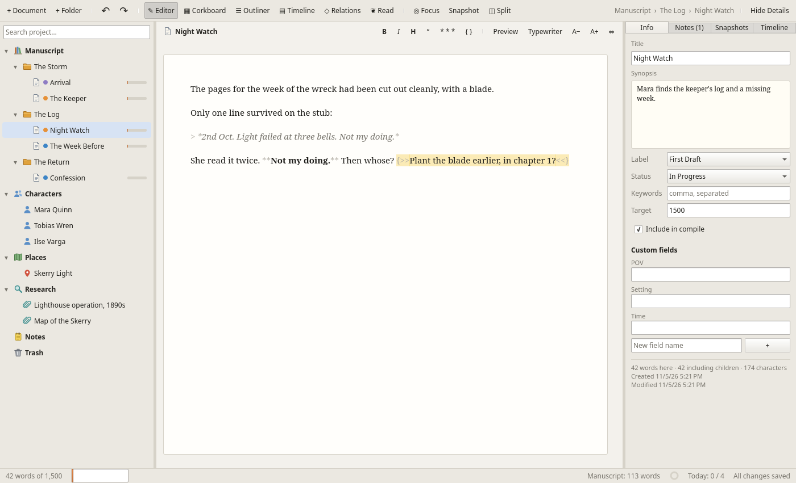

# Wordloom

A writing studio for novels and other long-form work, built in **Rust** with a **Qt 6 / QML** interface.
Wordloom is organised around the same ideas as Scrivener (a binder, index cards, an outliner,
snapshots, compile) without copying it, and adds a **story-timeline Gantt chart** for plotting
characters, events and plotlines in time.

It runs on Linux today. The code is written to build unchanged on Windows and macOS, since Qt and
Rust both support those platforms. CI currently builds Linux only: Windows CI is paused
until the Linux version is complete (it passed when last enabled), and macOS CI waits on a Qt
version that supports the macOS 26 SDK.



More screenshots: [timeline](docs/screenshots/timeline.png) ·
[relationship map](docs/screenshots/relations.png) · [corkboard](docs/screenshots/corkboard.png) ·
[split editor](docs/screenshots/split.png).

## Features

| Area | What you get |
|---|---|
| **Binder** | A project tree with fixed sections (Manuscript, Characters, Places, Research, Notes, Trash). Drag and drop, inline rename (F2), keyboard moves (Ctrl+↑/↓ to move, Ctrl+←/→ to outdent/indent), duplicate, split at cursor, merge, convert type, trash/empty trash. Clicking a document opens it in the editor; clicking a folder with no text of its own shows its contents on the corkboard. |
| **Editor** | A distraction-light paper page that fills the window (or a fixed column width: ⇔ cycles Fit, 560 … 1100 px), adjustable font size, Markdown preview, and typewriter scrolling. The page scrolls to keep the caret in view as you type. In a narrow pane the editor's view and format buttons move into a ⋯ menu. **Styled Markdown**: headings, **bold**, *italic*, block quotes and scene breaks are shown styled as you type, with their Markdown markers faded, while the file on disk stays plain Markdown. The format bar (B, I, H, “, * * *) and Ctrl+B / Ctrl+I add or remove the markers for you (Ctrl+Z undoes them), and View ▸ Styled Markdown turns styling off. **Composite mode**: select a folder and every document inside it appears as one continuous manuscript you can edit, with each part saving separately. **Split editor** (◫ or Ctrl+\\, or *Open in Split Editor* in the binder): keep one document beside the main view while you work elsewhere; ⇄ swaps the two. The same document can be open in both panes. |
| **Focus mode** | F11 hides everything except the page. |
| **Corkboard** | Index cards with label colour strips, status stamps and word counts. Edit titles and synopses on the card, resize cards, reorder them from the context menu. |
| **Outliner** | A table of the whole subtree: synopsis, label, status, words, target and progress, all editable in place. |
| **Details panel** | The right-hand panel (Show/Hide Details, Ctrl+Alt+I): synopsis, label, status, keywords, word target, include-in-compile, **character sheets / place sheets / scene facts** (custom fields), document notes, snapshots, and the timeline events linked to the item. |
| **Undo & redo** | Project-wide: ↶/↷ on the toolbar and Edit ▸ Undo/Redo (Ctrl+Z / Ctrl+Shift+Z when you're not typing in a text box) reverse binder moves, renames, trash and empty trash, replace-all, metadata, labels, targets, and every timeline edit. The menu names the step (“Undo Move Event”). Typing has the editor's own undo, so undoing an old change never throws away text written since. Up to 200 steps per session. |
| **Relationship map** | ◇ Relations (Ctrl+6) shows every character as a card you can drag around, with labelled arrows for how they relate (“Mara *distrusts* Tobias”). Add a relationship from the toolbar or a card's right-click menu, and click a label to edit it, add notes, swap its direction or delete it. The Details panel lists each character's relationships. |
| **Research files** | Import images and PDFs (File ▸ Import File…, or drop files on the binder). They're copied into the project and shown in the editor: images with fit / zoom, PDFs page by page. Other file types open in your default app. |
| **Snapshots** | Named versions per document. Restoring one first saves the current text as a snapshot, so you can't lose work that way. **Compare…** shows a snapshot side by side with the current text (or another snapshot): paragraphs line up, changed words are highlighted, and a count shows words added and removed. |
| **Search & replace** | Searches titles, text, synopses, notes and keywords across the project, with snippets. Replace-all works across every document. |
| **Compile** | Exports the manuscript to EPUB (with a table of contents, one file per chapter), DOCX (named styles, chapters on new pages), Markdown, print-styled HTML, or plain text, with a live preview. No Pandoc or Calibre needed. Options cover the title page, chapter headings and numbering, scene headings, and the scene separator. |
| **Statistics & targets** | Word counts for the manuscript and the whole project, words written today, writing streak, reading time, a 30-day history chart, a manuscript target with deadline (and the words per day needed to hit it), and a daily session target. |
| **Labels & statuses** | Editable lists with colours. |
| **Themes** | Follows the system light/dark setting, or you can force either one. |

### The timeline (Gantt)

- **Tracks** are rows: characters, plotlines, places, themes, or anything else. **⟳ Sync Cast**
  creates a track for every character and place in the binder and keeps the names in step.
- **Events** are bars on a story clock measured in whole units ("Day" by default; it can be Hour,
  Year, Chapter, and so on). Set a day-0 date and the ruler shows calendar dates. An event with
  length 0 is a **milestone**.
- **Participants**: an event sits on one track but can involve others. It shows as an outlined
  "ghost" bar on each participant's row, so you can see where everyone is at any moment.
- **Dependencies** ("happens after") are drawn as arrows. With **Cascade** on, moving an event
  pushes the events that depend on it later.
- **Conflict detection** marks a character who is in two overlapping events, or an event that
  starts before something it depends on has finished. The ⚠ button lists every problem in plain
  language.
- **Scene links**: link events to manuscript scenes, or right-click an event and choose **Write
  This Scene** to create the scene. The **Chronology** panel lists scenes in story order next to
  their manuscript position and flags (↺) the ones told out of sequence.
- **Markers** draw vertical lines for act breaks or turning points.
- **Lanes** groups the tracks into swim lanes by kind (Characters, Places, Plotlines, Themes,
  Other). Click a lane's header to collapse it; ▴/▾ then move a track within its lane.
- Drag a bar to move it, drag its right edge to change its length, double-click it to edit, and
  double-click an empty spot on a row to add an event there. Ctrl+scroll zooms around the cursor,
  and **Fit** shows the whole timeline.

## Installing on Linux

Every push to `main` builds two packages. Download them from the artifacts of the latest
[CI run](https://github.com/generalkael/wordloom/actions/workflows/ci.yml).

**AppImage:** a single file that runs on most distributions from Ubuntu 22.04 on. It bundles Qt,
including the PDF viewer and Wayland and X11 support.

```sh
chmod +x Wordloom-x86_64.AppImage
./Wordloom-x86_64.AppImage
```

**Flatpak:** runs on the KDE runtime from Flathub, which `flatpak` installs for you, and shows up
in your app launcher. The sandbox can read and write your home folder, where projects live.

```sh
flatpak install --user Wordloom.flatpak
flatpak run io.github.generalkael.Wordloom
```

To build them yourself, run `packaging/linux/build-appimage.sh` (it downloads linuxdeploy into
`.appimage-tools/`), or
`flatpak-builder --user --install --install-deps-from=flathub --force-clean build-dir packaging/flatpak/io.github.generalkael.Wordloom.yml`.
The desktop entry, icon and AppStream metadata are in `packaging/linux/` and use the app ID
`io.github.generalkael.Wordloom`.

The Flatpak build is offline, as Flathub requires: every crate is listed with its checksum in
`packaging/flatpak/cargo-sources.json`. After changing `Cargo.lock`, regenerate it with
`packaging/flatpak/cargo-sources.py`; CI fails if it is out of date.

## Building

You need Rust (stable), Qt 6.5 or later with Qt Quick / Quick Controls 2 / Qt Shapes, and a C++
compiler. The build finds Qt through `qmake`. If it isn't on your `PATH`, set `QMAKE=/path/to/qmake6`.

```sh
cargo run --release -p wordloom                    # start
cargo run --release -p wordloom -- path/to/Book.wordloom   # open a project
cargo test --workspace                             # core test-suite (no Qt needed at runtime)
```

**Linux:** install your distribution's Qt 6 packages (Arch: `qt6-base qt6-declarative`; Debian/Ubuntu:
`qt6-base-dev qt6-declarative-dev qml6-module-qtquick-controls qml6-module-qtquick-dialogs
qml6-module-qtquick-layouts qml6-module-qtquick-shapes qml6-module-qtcore`). The PDF viewer also
needs Qt PDF (Arch: `qt6-webengine`; Debian/Ubuntu: `qml6-module-qtquick-pdf`); without it, PDFs
open in your default app instead.

**Windows:** install Qt 6 with the online installer (MSVC kit), then set
`QMAKE=C:\Qt\6.x.x\msvc2022_64\bin\qmake.exe`. After building, run `windeployqt --qmldir crates/wordloom-app/qml target\release\wordloom.exe` to bundle the Qt libraries.

**macOS:** `brew install qt` (or use the Qt installer), then `macdeployqt` to bundle the libraries.

To try it out, click **Explore the Sample** on the start screen. It creates a short sample novel
in `~/Documents/Wordloom` with chapters, characters, labels, an imported map in Research, a
snapshot of an earlier draft to compare, a relationship map, and a timeline that includes
dependencies and a deliberate conflict.

## Keyboard shortcuts

Ctrl is ⌘ on macOS.

| Action | Keys |
|---|---|
| New project / open / save | Ctrl+N (start screen) · Ctrl+O · Ctrl+S |
| New document / new folder | Ctrl+N · Ctrl+Shift+N |
| Duplicate · split at cursor · merge with next | Ctrl+D · Ctrl+K · Ctrl+Shift+M |
| Undo / redo project changes (outside text boxes) | Ctrl+Z · Ctrl+Shift+Z |
| Import file into Research | Ctrl+Shift+I |
| Take snapshot | Ctrl+5 |
| Compile / export | Ctrl+Shift+E |
| Find in project · writing statistics | Ctrl+Shift+F · Ctrl+Shift+T |
| Editor · corkboard · outliner · timeline | Ctrl+1 · Ctrl+2 · Ctrl+3 · Ctrl+4 |
| Relationship map | Ctrl+6 |
| Split editor on / off | Ctrl+\\ |
| Focus mode (leave with Esc) | F11 |
| Show / hide the Details panel | Ctrl+Alt+I |
| Bold · italic (in the editor) | Ctrl+B · Ctrl+I |
| Larger / smaller editor text | Ctrl++ · Ctrl+− |
| Zoom an image in the viewer | Ctrl+scroll |
| **Binder:** move between items · expand/collapse | ↑ ↓ · → ← |
| **Binder:** move item up/down · indent/outdent | Ctrl+↑ ↓ · Ctrl+→ ← |
| **Binder:** open · rename · move to trash | Enter · F2 · Delete |

## Project format

A project is a folder, `Title.wordloom/`. Apart from files you import, it is all plain text, so it
works with git, Dropbox and diff tools, and you can still read it without Wordloom:

```
Title.wordloom/
  project.json          binder tree, metadata, labels, statuses, timeline, relationships, stats
  content/<uuid>.md     one Markdown file per document that has text
  snapshots/<uuid>.json saved versions of a document
  files/<uuid>.<ext>    imported research files (images, PDFs, …), copied in unchanged
  backups/              rolling copies of project.json (one per 10 minutes, last 20 kept)
```

Imported files are never deleted, even when their item is trashed and the trash emptied, so undo,
duplicates and backups can always find them. To reclaim space, delete files in `files/` that no
item in `project.json` refers to. **Save As** copies `files/` and `snapshots/` to the new project.

Your preferences (light/dark, editor font size, page width, styled Markdown, which panels are
shown, timeline lanes and the window size) are remembered between runs in
`~/.config/Wordloom/Wordloom.conf` (in the Flatpak, under `~/.var/app/io.github.generalkael.Wordloom/`).
They are per user, not stored in projects.

Every write goes to a temporary file that is then renamed into place, so a crash can't leave a
file half-written. Wordloom autosaves every 15 seconds while there are unsaved changes, and
saves again when it closes.

## Architecture

```
crates/
  wordloom-core/   pure Rust, no Qt: all behaviour, fully unit-tested
    model.rs       binder arena (flat map + ordered children), tree operations, metadata
    timeline.rs    Gantt engine: tracks, events, participants, dependencies,
                   cycle rejection, cascade, conflict detection, chronology
    storage.rs     bundle format, atomic writes, backups, snapshots, imported files
    compile.rs     manuscript → Markdown / HTML / plain text
    epub.rs        EPUB 3 package
    docx.rs        Word document
    zip.rs         minimal zip writer for EPUB and DOCX
    search.rs      search & case-insensitive replace
    relations.rs   character relationships and map positions
    diff.rs        side-by-side snapshot comparison (paragraphs, then words)
    stats.rs       word counting, targets, daily history, streaks
    history.rs     project-wide undo/redo (structure snapshots + text diffs)
    session.rs     an open project + its JSON-shaped API
    api.rs         call(method, argsJson) dispatcher used by the UI
    demo.rs        the sample project
  wordloom-app/    the Qt front end
    src/controller.rs  one cxx-qt QObject (QML singleton `Wordloom`) wrapping api::App
    src/styler.*       C++ QSyntaxHighlighter for styled Markdown (MarkdownStyler in QML)
    qml/*.qml          all views and dialogs
```

The UI talks to Rust through a single invokable, `Wordloom.call(method, argsJson)`, which the
`Api` QML singleton wraps. Any call that changes data bumps a `revision` property, and each view
re-queries what it shows when that happens. This keeps the FFI surface tiny: adding a feature is
a Rust method, one line in `api.rs`, and some QML.

Developer aid: `wordloom PROJECT --screenshots=DIR` opens each view and dialog in turn, saves a
PNG of each, and quits. It also works headless with `QT_QPA_PLATFORM=offscreen`.

## Roadmap

- Packaged installers for Windows (MSI) and macOS (DMG); the Linux AppImage and Flatpak are done
- Flathub submission: the manifest and metadata are ready; what's left is opening the submission
  pull request on flathub/flathub

## License

Wordloom is released under the [MIT License](LICENSE).
